<!-- ============ BANNER (imagen de fondo + nombre animado) ============ -->

  

<!-- ============ TEXTO TIPO MAQUINA DE ESCRIBIR ============ -->

  

<!-- ============ SOBRE MI ============ -->
<h2 align="center">Sobre mí</h2>

Soy **Breyder Duran**, estudiante de desarrollo web con base técnica en sistemas y redes. Me gusta aprender tecnologías nuevas y aplicarlas en proyectos reales.

Actualmente estudio el **Grado Superior en Desarrollo de Aplicaciones Web (DAW)** en el **IES Infanta Elena**, y soy **Técnico en Sistemas Microinformáticos y Redes (SMR)** con experiencia previa en entorno empresarial.

Me enfoco en desarrollo web **full-stack**, optimización **SEO** y administración de sistemas.

Mi objetivo es simple: realizar mis **prácticas curriculares (FCT)** aportando compromiso, orden y aprendizaje rápido a un equipo de desarrollo.

 

<!-- ============ CONECTA ============ -->
<h2 align="center">Conecta conmigo</h2>

  
  &nbsp;
  
  &nbsp;
  

  

<!-- ============ TECNOLOGIAS ============ -->
<h2 align="center">Tecnologías</h2>

  

<!-- ============ LO QUE BUSCO ============ -->
<h2 align="center">Lo que busco</h2>

<table align="center">
  <tr>
    <td align="center" width="33%">
      <h4>Prácticas (FCT)</h4>
      Un equipo de desarrollo donde aportar y seguir creciendo
    </td>
    <td align="center" width="33%">
      <h4>Full-stack</h4>
      Proyectos de desarrollo web, front y back
    </td>
    <td align="center" width="33%">
      <h4>Aprender rápido</h4>
      Compromiso, orden y ganas de mejorar cada día
    </td>
  </tr>
</table>

<!-- ============ ESTADISTICAS ============ -->
<h2 align="center">Estadísticas</h2>

  

 

  

 

<!-- ============ SNAKE ============ -->

  

<!-- ============ DESPEDIDA ============ -->

  

  

